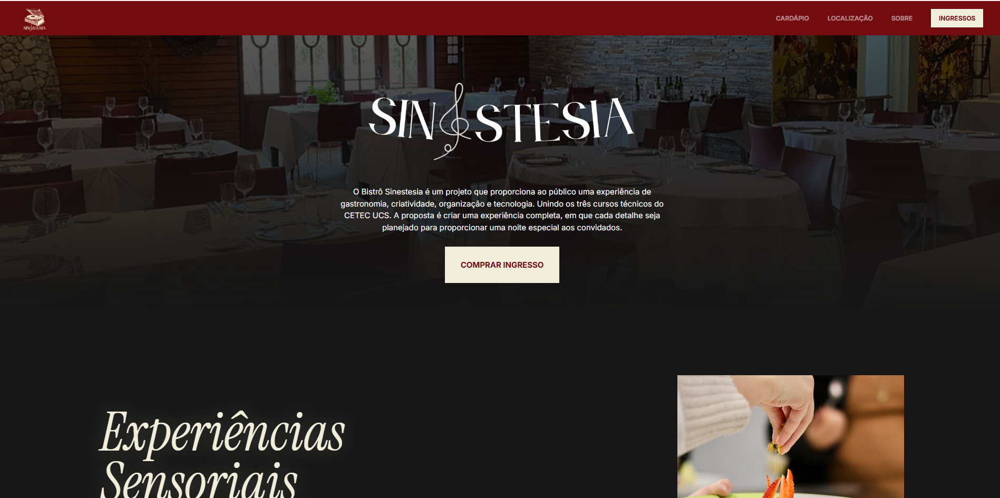
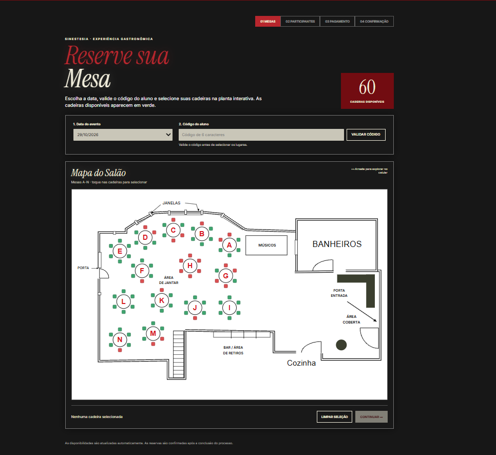
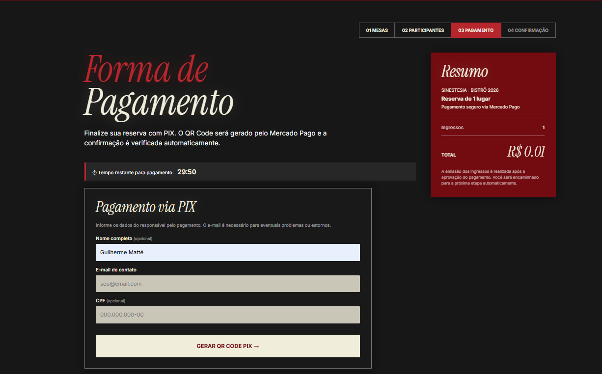
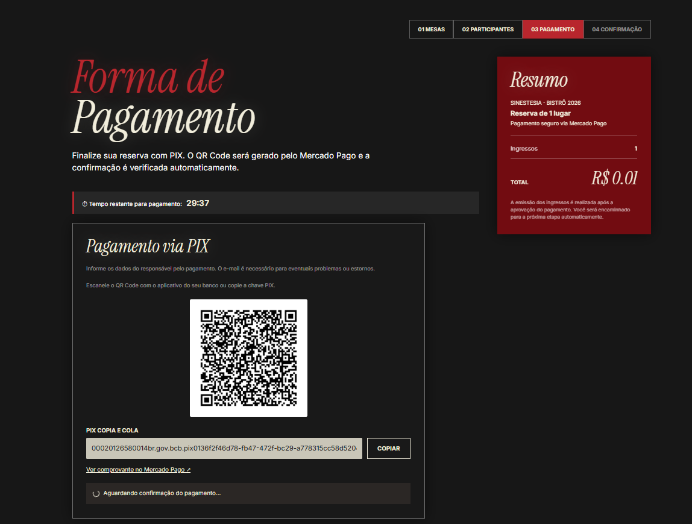
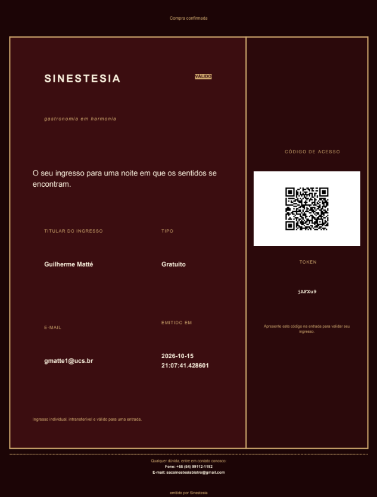
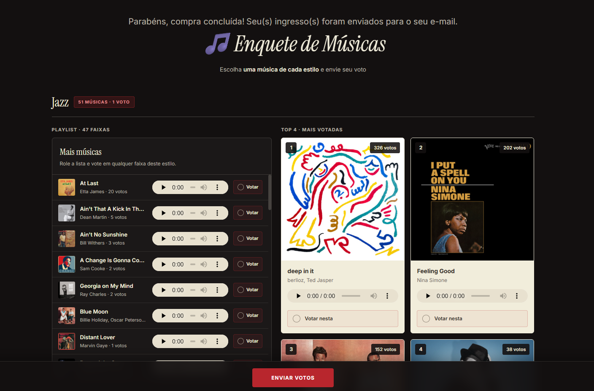
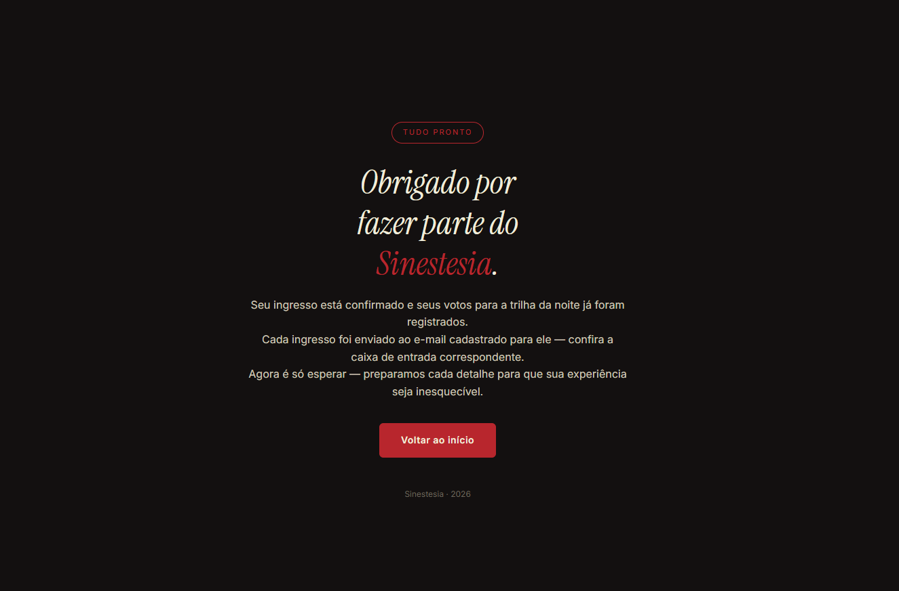
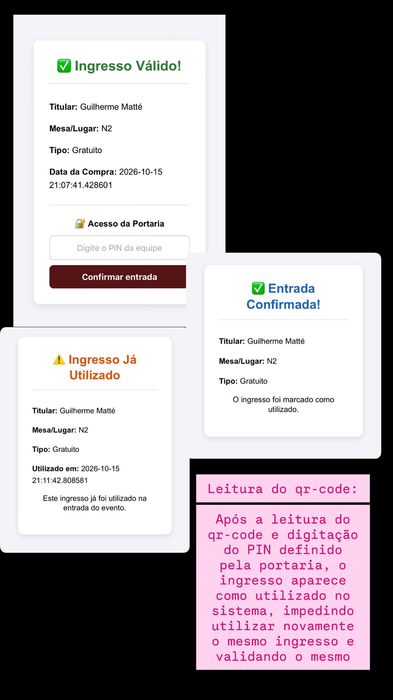

# 🍽️ Bistrô 2026

Sistema web do **Bistrô 2026**, projeto integrador da UCS CETEC que une os cursos técnicos de Informática, Administração e Gastronomia. O sistema cuida da **venda de ingressos com escolha de lugares**, do **pagamento via Pix (Mercado Pago)**, da **entrada no evento por QR code**, de um **painel administrativo de relatórios** e de uma **votação de músicas**.

Feito em Python/Flask, com banco SQLite compartilhado entre os serviços.

---

## ✨ O que o sistema faz

### 🎟️ Venda de ingressos (`mesas-ingressos`)
- Mapa de mesas e cadeiras, com reserva por dia do evento e cronômetro que segura o lugar enquanto o comprador preenche os dados.
- Identificação do comprador por código de aluno de 6 caracteres, com controle de quantos ingressos ainda podem ser usados por aluno.
- Três tipos de ingresso (gratuito, meia e inteira), com valor calculado pelo servidor.
- Pagamento por **Pix** pela API de Pagamentos do Mercado Pago (Checkout Transparente): o sistema gera o QR code, a tela consulta o status do pagamento e a página de sucesso só abre depois da confirmação.
- **Webhook do Mercado Pago** (`POST /webhook/mercadopago`) com validação da assinatura HMAC (`x-signature`) como fonte de verdade da aprovação.
- Quando o Pix falha, expira ou é recusado, os lugares e os usos do código de aluno são liberados.
- Ingresso em **PDF com QR code, dia do evento e lugar** (mesa e cadeira), enviado por e-mail depois do pagamento.
- **Validação na portaria**: o staff lê o QR code e confirma a entrada com um PIN, e o ingresso fica marcado como utilizado.

### 📊 Painel de relatórios (`relatorios`)
- Acesso restrito por login de administrador.
- Visão geral, ingressos vendidos, pagos, não pagos e restantes (inclusive por aluno), resumo financeiro, participantes por curso, restrições e ranking de músicas.

### 🎵 Votação de músicas (`musicas`)
- Página para votar nas músicas do evento, com contagem de votos gravada no banco compartilhado.

---

## 🖼️ Telas

🌐 **Site do evento:** [sinestesiabistro.com.br](https://www.sinestesiabistro.com.br)

<table>
  <tr>
    <td align="center">
      <br>
      <sub>Site do evento</sub>
    </td>
    <td align="center">
      <br>
      <sub>Mapa de mesas e escolha do dia</sub>
    </td>
  </tr>
  <tr>
    <td align="center">
      <br>
      <sub>Pagamento via Pix</sub>
    </td>
    <td align="center">
      <br>
      <sub>QR code do Pix</sub>
    </td>
  </tr>
  <tr>
    <td align="center">
      <br>
      <sub>Ingresso em PDF com QR code, dia e lugar</sub>
    </td>
    <td align="center">
      <br>
      <sub>Votação de músicas</sub>
    </td>
  </tr>
  <tr>
    <td align="center">
      <br>
      <sub>Página de agradecimento</sub>
    </td>
    <td align="center">
      <br>
      <sub>Leitura do QR code na portaria</sub>
    </td>

  </tr>
</table>

---

## 🛠️ Tecnologias

Python · Flask · SQLite · Flask-Login · Flask-WTF/WTForms · SDK do Mercado Pago · xhtml2pdf · qrcode · Gunicorn · HTML, CSS e JavaScript

---

## 📂 Estrutura

```
.
├── mesas-ingressos-app.py     # inicia ingressos + mapa de lugares (porta 8080)
├── relatorios-app.py          # inicia o painel de relatórios (porta 5003)
├── app_musicas.py             # inicia a votação de músicas (porta 4444)
├── criar_admin_relatorios.py  # cria um administrador para o painel
├── baixar_musicas.py          # downloader incremental de músicas
├── mesas-ingressos/           # backend (ingressos, mapa_mesas) e frontend
├── relatorios/                # backend e frontend do painel
├── musicas/                   # aplicação da votação
├── docs/img/                  # capturas de tela usadas neste README
├── requirements.txt
└── .env.example
```

Os três serviços leem o mesmo arquivo `.env` da raiz e usam o mesmo banco SQLite (`database/bistro.db`, criado automaticamente na primeira execução).

---

## 🚀 Como rodar

Requisitos: Python 3 e pip.

```bash
git clone https://github.com/arthurjww/Bistro-2026.git
cd Bistro-2026
git checkout deploy

python -m venv .venv
source .venv/bin/activate        # no Windows: .venv\Scripts\activate
pip install -r requirements.txt

cp .env.example .env             # no Windows: copy .env.example .env
                                 # depois preencha os valores (veja abaixo)
```

Iniciar cada serviço, cada um em um terminal:

```bash
python mesas-ingressos-app.py    # http://127.0.0.1:8080
python relatorios-app.py         # http://127.0.0.1:5003
python app_musicas.py            # http://127.0.0.1:4444
```

Para acessar o painel, crie um administrador primeiro:

```bash
python criar_admin_relatorios.py
```

---

## 🔐 Variáveis de ambiente

Copie `.env.example` para `.env`. O arquivo `.env` está no `.gitignore` e **nunca deve ser enviado ao repositório**.

| Variável | Para que serve |
|---|---|
| `SECRET_KEY` | Chave de sessão do Flask na venda de ingressos |
| `RELATORIOS_SECRET_KEY` | Chave de sessão do painel de relatórios |
| `MP_ACCESS_TOKEN` | Token privado do Mercado Pago (somente no backend) |
| `MP_PUBLIC_KEY` | Chave pública do Mercado Pago |
| `MP_WEBHOOK_SECRET` | Segredo usado para validar a assinatura do webhook |
| `MAIL_SERVER`, `MAIL_PORT`, `MAIL_USERNAME`, `MAIL_PASSWORD`, `MAIL_DEFAULT_SENDER` | Envio do ingresso por e-mail (SMTP) |
| `STAFF_PIN` | PIN usado pela portaria para confirmar a entrada |
| `CSV_ALUNOS` | Caminho, a partir de `mesas-ingressos/`, do CSV com os alunos e seus códigos |
| `MUSICAS_REDIRECT_URL` | Endereço da votação de músicas, para onde o comprador é enviado depois do pagamento confirmado |
| `HOME_REDIRECT_URL` | Endereço da página inicial do evento, usado no link da página de agradecimento da votação |

Opcionais: `BISTRO_DATABASE_PATH`, `INGRESSOS_HOST`, `INGRESSOS_PORT`, `RELATORIOS_HOST`, `MUSICAS_HOST`, `MUSICAS_PORT` e `FLASK_DEBUG`.

Para testar pagamentos, use as credenciais de teste do Mercado Pago. Para o webhook funcionar, a URL `/webhook/mercadopago` precisa ser pública e estar cadastrada no painel do Mercado Pago.

---

## 🛒 Fluxo de compra

1. O comprador informa o código de aluno e escolhe os lugares e a data no mapa.
2. O sistema reserva os lugares por tempo limitado.
3. O comprador preenche os dados de cada ingresso (nome, tipo, e-mail, telefone).
4. O sistema cria o pagamento Pix e mostra o QR code.
5. O Mercado Pago avisa o resultado pelo webhook, e o sistema confirma o pagamento.
6. O ingresso em PDF, com QR code, é enviado por e-mail.
7. Na portaria, o QR code é validado e o ingresso passa a constar como utilizado.

---

## 👥 Equipe

Projeto desenvolvido por alunos do Curso Técnico de T.I - CETEC/UCS. 

---

## 📄 Licença

Veja os arquivos `LICENSE` dentro de cada módulo.
